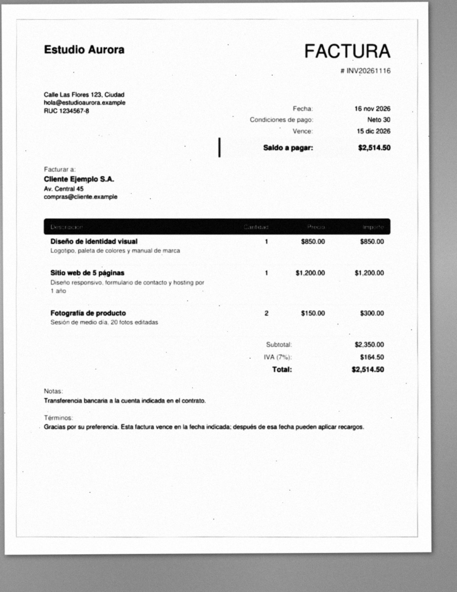

<p align="center"></p>

# Scanner Effect

Dale **efecto de escáner viejo** a cualquier foto, captura o PDF: recetas, recibos, cartas, contratos, lo que sea.
Se hace **en tu navegador**: nada se sube a ningún servidor y no hay cuentas ni historial.



## Qué hace
- Toma una **foto**, una imagen o un **PDF** (varias páginas y varios archivos a la vez).
- **Filtros:** blanco y negro (como fotocopia), blanco y negro suave (con grises), escala de grises, color, **color mágico** (papel blanco y colores vivos), **sepia** (papel antiguo) y **fax** (negro duro). Un logo o una zona negra grande se queda negra, sin hueco blanco.
- **Ajustes:** brillo, contraste y cantidad de grano y polvo del escáner.
- **Hoja:** Carta, A4, o ajustada a la imagen (vertical u horizontal sola).
- **Fondo de escáner:** gris con manchas, sombra de la hoja y motas de polvo; **siempre** sale, para que parezca un escáner viejo.
- **Bordes finos** alrededor del documento y **leve inclinación**: opcionales.
- Margen blanco de la hoja, calidad del archivo y botón **Otra variación** (cambia la inclinación, las motas y las manchas).
- Descarga **PDF** (varias páginas) o **JPG**. Funciona bien en el celular.

## Usar
Es una página estática, no hay nada que instalar. Solo necesita servirse por `http` (los navegadores no dejan abrir PDF desde `file://`):

```bash
git clone https://github.com/KleverBatista-max/scanner-effect
cd scanner-effect
python3 -m http.server 8000
# abre http://127.0.0.1:8000
```

También sirve en cualquier hosting estático (GitHub Pages, Netlify, tu propio servidor). Si lo expones a internet y no quieres que lo use cualquiera, ponle una contraseña desde tu servidor web.

## Personalizar
- Colores de la interfaz: variables CSS al inicio de `index.html`.
- El efecto: funciones `filtro()`, `bordeFino()` y `efectoEscaner()` en el `<script>`.
- Resolución de salida: `DIMS` (150 dpi).

## English
Give any photo, screenshot or PDF an **old-scanner look**, entirely in your browser (nothing is uploaded). Filters: black & white, soft B&W, grayscale, color, magic color, sepia, fax; brightness / contrast / grain sliders; Letter / A4 / fit-to-image, optional thin borders and slight skew; the gray scanner bed with shadow and dust always shows. Exports PDF or JPG. Run `python3 -m http.server` and open it.

## Licencia
Todos los derechos reservados (ver `LICENSE`): el código se puede ver, pero no copiar ni usar sin permiso. Incluye [jsPDF](https://github.com/parallax/jsPDF) (MIT) y [PDF.js](https://github.com/mozilla/pdf.js) (Apache-2.0): ver `THIRD_PARTY.md`.
